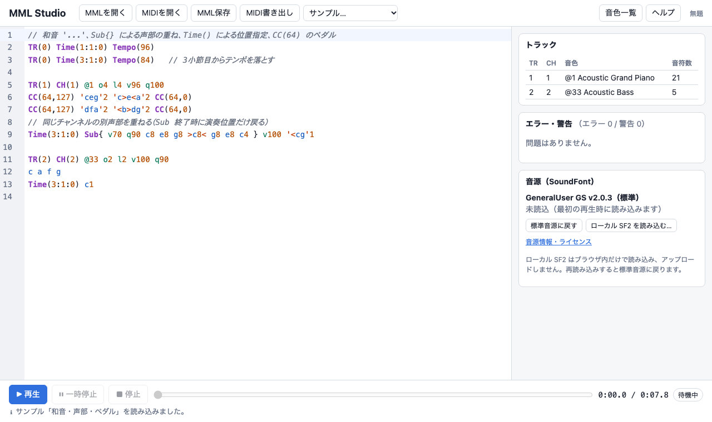

# MML Studio

ブラウザで MML（Music Macro Language）を書いて、その場で GM（General MIDI）音源で演奏できる Web アプリです。
MML の解析・コンパイル・MIDI（SMF）書き出しはすべて独自の TypeScript エンジン（`src/engine/`）で行い、
音声合成だけを [spessasynth_lib](https://github.com/spessasus/spessasynth_lib) に任せています。仕様は [SPEC.md](SPEC.md)。

> **進捗**: Phase 0〜5 実装済み（MML プレイヤー MVP、MIDI インポート／MML 変換、安定化）。



## 主な機能

- MML エディタ（CodeMirror 6、色分け、行・列付きエラーと波線、クリックで該当箇所へジャンプ）
- 1つの MML に複数トラック／複数 MIDI チャンネル、GM 128 音色、CH10 の GM ドラム
- 再生・一時停止・停止・シーク、現在時刻／曲長表示（スケジューリングは SpessaSynth の Sequencer）
- `.mml` の読み込み・保存、`.mid`（SMF Type 1 / PPQ 480）書き出し
- 標準音源 GeneralUser GS v2.0.3、ローカル `.sf2` への切り替え（アップロードなし）
- GM 音色一覧（検索・`@N` コピー）、ヘルプ、音源ライセンス表示、localStorage への下書き自動保存
- サンプル 5 曲（ピアノの音階／ピアノ＋ストリングス／ドラム入り3トラック／テンポ変更／和音・声部・ペダル）
- **MIDI インポート**: `.mid`（SMF Format 0/1）を開く／ドラッグ＆ドロップすると MML に変換（忠実度優先／読みやすさ優先）。
  変換結果は再コンパイルして元 MIDI と照合し、元 MIDI の直接再生と編集した MML の再生を切り替えて聴き比べられます

**対応ブラウザ**: AudioWorklet に対応したデスクトップ版の Chrome / Edge / Firefox / Safari の最新版。
自動 E2E テストは Chromium・Firefox・WebKit（Playwright）で実行しています。実機での試聴確認は Chrome のみです（Safari・Firefox の実機では未確認）。

## セットアップ

Node.js 22 以降。

```sh
npm install              # 依存のインストール（spessasynth の AudioWorklet を public/ に自動コピー）
npm run fetch-soundfont  # 標準音源 GeneralUser GS v2.0.3 を作者の公式 GitHub から取得（SHA-256 検証）
npm run dev              # http://localhost:5173/
```

| コマンド | 内容 |
|---|---|
| `npm run dev` | 開発サーバー |
| `npm run build` | 型チェック + 本番ビルド（`dist/`） |
| `npm run preview` | ビルド結果の確認 |
| `npm run test` | ユニットテスト（Vitest、ブラウザ・音源不要） |
| `npm run test:e2e` | E2E テスト（Playwright、Chromium / Firefox / WebKit。初回は `npx playwright install chromium firefox webkit`。1 つだけなら `-- --project=chromium`） |
| `npm run lint` / `npm run typecheck` | 静的検査 |

### 音源ファイルについて

- `public/soundfonts/GeneralUser-GS.sf2`（約 32MB）は Git に含めず、`npm run fetch-soundfont` で
  作者の公式リポジトリ（固定コミット）から取得します。ライセンス原文は `public/licenses/` に同梱しています。
- 音源が無い状態で再生すると、404 である旨と対処方法が表示されます。その場合もローカル SF2 を読み込めば演奏できます。
- 公開サイトでは自サイトに置いたコピーを配信してください（作者のダウンロードファイルへの直接リンクは禁止されています）。

## MML Studio 方言の概要

詳しくはアプリの「ヘルプ」または [docs/MML_REFERENCE.md](docs/MML_REFERENCE.md) を参照してください。

```mml
TR(0) Tempo(120)          // TR(0) はテンポ専用のコンダクタートラック
TR(1) CH(1) @1            // トラック1、チャンネル1、GM 音色 @1（Acoustic Grand Piano）
 o4 l4 v105 q90
 c e g >c
TR(3) CH(10)              // チャンネル10は GM ドラム
 l8 n36 n42 n38 n42
```

### サクラ MML との違い（重要）

MML Studio は**サクラ MML と完全互換ではありません**。サクラのコード・ライブラリは一切使っていません。

| 項目 | MML Studio |
|---|---|
| 小文字 `t` | **テンポ**（BPM）。サクラでは発音タイミング調整 |
| `o4c` | MIDI ノート 60（中央の C）。`o4a` = 69（A4 = 440Hz） |
| `v` | MIDI ベロシティ 0〜127（初期値 100） |
| `q` | 音長に対する発音長の割合 %（0〜100、初期値 90） |
| `@N` | GM 音色 1〜128（UI 表記）。MIDI の Program 番号は N−1（0〜127） |
| 未対応 | `[ ]` ループ、`{ }` 連符、マクロ、変数、ストトン、日本語構文、異音高スラー（エラーになります） |

### トラックとチャンネル、ドラム

- `TR(N)` はトラック（独立した時間軸）、`CH(N)` は MIDI チャンネル。トラック同士で同じチャンネルは共有できません。
- 初期チャンネル: TR(1〜9) → 1〜9、TR(10〜15) → 11〜16。TR(16〜32) は `CH(N)` の指定が必要です。
- ドラム（`CH(10)`）は `n36`（Bass Drum）、`n38`（Snare）、`n42`（Closed Hi-Hat）のようにノート番号で書くのがおすすめです。
  `o4c` は「ド」ではなくノート 60 の打楽器になります。ドラムでは `@` は使えません。

## ファイルの入出力

- **MMLを開く**: UTF-8 のテキスト（`.mml` / `.txt`、最大 2 MiB）。編集中の内容がある場合は確認します。
- **MML保存**: 現在の内容を `.mml` としてダウンロードします。
- **MIDI書き出し**: SMF Type 1 / PPQ 480 の `.mid`。MML にエラーがある間は無効です。
- 編集内容はこのブラウザの localStorage に自動で下書き保存されます（ブラウザのデータを消去すると消えます）。
- MML・MIDI・SF2 はすべてブラウザ内で処理し、外部へ送信しません。

## MIDI インポート（MIDI → MML）

- 「MIDIを開く」またはファイルをドロップ（最大 20 MiB、30 万イベント、Note On 10 万）。読み取り・変換・検証は Web Worker 内で行い、外部へ送信しません。
- **忠実度優先**（初期値）: `TR(0) TempoUS(...)`、チャンネルごとに `TR(N) CH(N)`、`Time(M:B:S)`・`v`・`q%N`・`n60%N`・和音 `'n60 n64'%N`・`Sub{}` で
  音高・ベロシティ・開始 tick・実際の Note Off tick・テンポ（μs）・音色・CC・PB を再現します。生成した MML を独自コンパイラで再コンパイルし、
  元 MIDI（480 PPQ に丸めたもの）とイベント単位で一致しない場合は成功扱いにしません。
- **読みやすさ優先**: 1/8・1/16・1/32 グリッドに量子化し、音名・オクターブ・分母式の音長・休符・和音・声部（`Time` で重ねる）で書きます。
  開始位置・長さの差はインポート情報に表示します。量子化で同じ音高が同じ位置に重なるチャンネルは正確な tick で出力します。
- 元の PPQ から 480 PPQ へはイベントごとに最も近い tick に丸め、最大誤差を表示します。
- MML にできないイベント（拍子、調号、歌詞などのテキスト、SysEx、アフタータッチ、ドラムの Program Change）は件数付きで表示します。
  元 MIDI のバイト列はそのまま保持し、「元 MIDI」を選ぶと変換前のファイルを直接再生します。MML を編集しても元 MIDI は変わりません。
- 変換モードを変えて再変換するとき、MML を編集していれば確認し、「変換前の MML に戻す」で直前の内容に戻せます。
- Format 2、SMPTE 時間単位、壊れた VLQ・チャンク・データの MIDI は理由を表示して読み込みません。
  実在のファイルに多い軽微な不整合（チャンク長のずれ、メタイベント後のランニングステータス、MacBinary/RMID 形式）は警告付きで読み込みます。

## GitHub Pages への公開

```sh
BASE_PATH=/<リポジトリ名>/ npm run build   # 例: BASE_PATH=/mml-studio/ npm run build
```

`dist/` を GitHub Pages 等に配置します。`.github/workflows/pages.yml` は main への push で
音源の取得（固定コミット・SHA-256 検証）→ lint → test → `BASE_PATH=/<リポジトリ名>/` でビルド → GitHub Pages へ公開を行います
（リポジトリの Settings → Pages で Source を "GitHub Actions" にしてください。このワークフローは手元では未実行です）。音源と AudioWorklet は `import.meta.env.BASE_URL` 基準で読むため、サブパスでも動作します
（`BASE_PATH=/mml-studio/ npm run build && BASE_PATH=/mml-studio/ npx vite preview` で確認できます）。
ビルド前に `npm run fetch-soundfont` で音源を配置してください（音源の無い公開ビルドは完成扱いにしません）。

## 既知の制限

- 再生は SpessaSynth の仕様で**最後の発音イベントで終了**します（末尾の休符や MIDI の End of Track までは待ちません）。
- MIDI インポート情報と元 MIDI は下書き保存しません（再読み込みすると MML の下書きだけが残ります）。
- `Time` の小節・拍は常に 4/4 座標です。元 MIDI の拍子は MML に残りません。
- 一時停止中に編集した内容は「再開」では反映されません。停止してから再生してください。
- ローカル SF2 は永続保存しません。SoundFont やブラウザによって音の鳴り方は異なります。
- 自動再生の制限で音声を開始できなかった場合（5 秒で判定）はエラーを表示します。もう一度「再生」を押すと再開できます。
- 2 MiB 近い MML では、入力後のエラー表示の更新が最大 2 秒ほど遅れます（コンパイル時間に応じて待ち時間を伸ばしています）。
- MIDI 変換用の Web Worker が使えない環境では、メインスレッドで変換します（その間は画面が止まります）。

## ライセンス

- 標準音源: GeneralUser GS v2.0.3 © S. Christian Collins — `public/licenses/GeneralUser-GS-LICENSE.txt`
- 音声合成: spessasynth_lib（Apache-2.0）— `public/licenses/spessasynth_lib-LICENSE.txt`
- 設計判断の記録: [docs/DECISIONS.md](docs/DECISIONS.md)、構成: [docs/ARCHITECTURE.md](docs/ARCHITECTURE.md)
